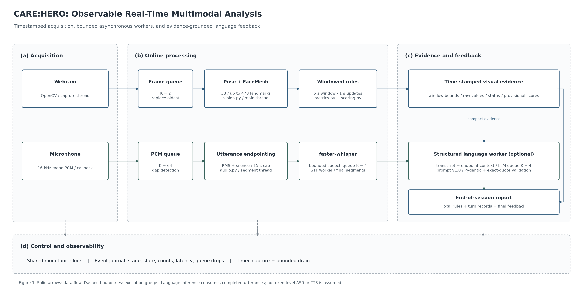

# CARE:HERO

**Observable Real-Time Multimodal Analysis for Caregiving Training**

카메라·마이크 입력에서 자세와 발화의 관찰 가능한 특징을 추출하고, 시간 구간별 규칙 평가와 근거 기반 언어 피드백을 생성하는 연구용 프레임워크.

[Architecture](#architecture) · [Quick Start](#quick-start) · [Processes and Outputs](#processes-and-outputs) · [LLM Engineering](#llm-engineering) · [Reproducibility](#reproducibility)

## Overview

CARE:HERO는 요양보호사 대응 연습에서 학습자의 행동을 돌아볼 수 있도록 개발하는 프로젝트다. 현재 프레임워크는 MediaPipe Pose·FaceMesh와 로컬 faster-whisper를 연결하고, 원시 측정·규칙 평가·LLM 해석을 구분해 기록한다.

실시간 경로는 영상의 최신 프레임을 처리하고, 음성을 침묵 또는 길이 기준으로 나누어 발화가 확정될 때 전사한다. LLM은 완료된 발화와 당시 자세 요약을 비동기로 해석하며, 종합 피드백은 세션 종료 후 생성한다. 이는 **실시간 입력과 발화 단위 준실시간 처리**이며, 토큰 단위 음성 스트리밍이나 AI 어르신의 음성 응답을 구현한 것은 아니다.

기존 파일 기반 분석은 재현용 batch 경로로 함께 제공한다. 구현과 출력의 상세 해설은 [코드 워크스루](docs/realtime_code_walkthrough.md), 언어 모델 설계는 [LLM engineering 문서](docs/realtime_llm_engineering.md)에 있다.

## Architecture



**Figure 1.** Timestamped acquisition, bounded asynchronous workers, and evidence-grounded feedback. 카메라·마이크는 같은 세션 시계를 사용한다. 큐는 최대 크기를 가지며, 단계별 상태·처리량·지연·누락을 별도 기록한다. LLM이 꺼져 있어도 로컬 규칙 평가와 결과 저장이 동작한다.

[SVG](docs/figures/realtime_architecture.svg) · [PDF](docs/figures/realtime_architecture.pdf) · [그림 생성 코드](services/ai/scripts/draw_realtime_architecture.py)

| 경로 | 실행 방식 | 재사용한 모델·평가 |
|---|---|---|
| Vision | 카메라 수집 스레드 → 최신 프레임 큐 → 메인 스레드 추론 | MediaPipe Pose·FaceMesh |
| Rules | 최근 구간 평가를 기본 1초마다 갱신 | 기존 YAML 규칙과 `scoring.py` |
| Audio | 마이크 콜백 → PCM 큐 → 발화 분할 → STT 작업 스레드 | faster-whisper |
| Language | 완료된 전사 → 유한 큐 → 구조화된 LLM 해석 | Responses API + Pydantic |
| Session | 입력 시간 제한 → 잔여 작업 정리 → 보고서 | 로컬 원시값·발화·모델 상태 |

## Repository Structure

```text
CARE_HERO/
├── apps/
│   ├── frontend/           # 화면·UI·백엔드 클라이언트
│   └── backend/            # API·세션·저장소·AI 연결
├── services/ai/            # AI 처리 코드와 독립적인 Python 패키지
│   ├── src/care_hero/
│   ├── scripts/
│   ├── configs/
│   ├── prompts/
│   ├── tests/
│   └── pyproject.toml
├── packages/contracts/    # 공동 데이터 계약·예시
├── docs/                  # 설계·코드 해설·구조도
├── experiments/
│   └── beginner_pipeline/ # 독립형 학습·평가 실험
├── outputs/               # 로컬 실행 결과; 버전 관리 제외
├── pyproject.toml         # 루트 테스트 설정
└── README.md
```

협업 담당 경계와 이동 내역은 [폴더 구조 안내](docs/team_structure.md), AI 실행 안내는 [AI workspace README](services/ai/README.md)에 정리했다. 프론트엔드·백엔드는 작업 공간을 마련한 상태이며, 공통 API 계약과 실제 서버·화면 구현은 담당자와 함께 추가한다.

## Quick Start

아래 명령은 저장소 루트에서 실행한다. Python 3.11 환경을 권장하며, 검증 환경은 macOS arm64와 Python 3.11이다.

```bash
python3.11 -m venv .venv
source .venv/bin/activate
python -m pip install -e './services/ai[dev,realtime]'
```

### Hardware-free demonstration

```bash
python services/ai/scripts/run_realtime.py --demo --duration 4
```

합성 카메라·음성·전사 fixture로 큐, 처리 상태, 시간 윈도우, 종료와 파일 저장을 검증한다. 실제 장치·모델·외부 API를 호출하지 않으며 결과는 `mode=synthetic_demo`로 표시한다.

### Webcam and microphone

```bash
# 카메라 분석 + 미리보기; Q 또는 Ctrl+C로 종료
python services/ai/scripts/run_realtime.py --camera 0 --duration 180

# 카메라 + 마이크 + 발화 단위 STT
python services/ai/scripts/run_realtime.py --camera 0 --audio --duration 180

# 미리보기 없이 실행
python services/ai/scripts/run_realtime.py --camera 0 --audio --headless

# 마이크 입력만 사용
python services/ai/scripts/run_realtime.py --audio-only --duration 60
```

macOS에서는 실행한 터미널 또는 앱에 카메라·마이크 권한이 필요하다. STT 모델은 첫 실행 때 내려받을 수 있다. 마이크 장치를 지정하려면 `--audio-device`를 사용하며, 장치 목록은 `python -m sounddevice`로 확인할 수 있다.

### Optional LLM

```bash
# OPENAI_API_KEY는 실행 환경에 설정한다.
# OPENAI_MODEL에는 계정에서 사용 가능한 구조화 출력 모델 ID를 지정한다.
python services/ai/scripts/run_realtime.py --camera 0 --audio --llm

# 또는 모델 ID를 명시한다.
python services/ai/scripts/run_realtime.py --audio-only --llm --model YOUR_MODEL_ID
```

기본 실행은 외부 API를 호출하지 않는다. `--llm`이 있으면 환경 변수와 모델 설정을 확인한 후 발화별 해석 및 종료 후 피드백을 요청한다. `.env` 자동 로드는 제공하지 않는다.

## Processes and Outputs

### Runtime defaults

| 항목 | 기본값 | 의미 |
|---|---:|---|
| 입력 세션 | 최대 180초 | 모델 초기화 이후의 입력 제한 |
| 목표 영상 분석 빈도 | 최대 10 Hz | 실제 처리량은 추론 시간에 따라 낮아질 수 있음 |
| 자세 평가 윈도우 / 갱신 | 5초 / 1초 | 최근 구간의 원시값·상태·provisional 점수 |
| 마이크 입력 | 16 kHz mono, 20 ms 블록 | PCM을 짧게 수집 |
| 발화 확정 | 침묵 약 0.8초 또는 최대 15초 | 발화 종료 후 STT 실행 |
| 최소 유성 구간 | 0.4초 | 매우 짧은 소리 후보 제외 |
| 영상 / PCM 큐 | 2 / 64개 | 초과 시 오래된 입력 제거 |
| STT / LLM 대기 큐 | 각 4개 | 초과한 새 작업은 누락으로 명시 |
| 종료 시 큐 정리 | 최대 30초 | 미완료 작업은 결과에 기록 |
| LLM 요청 제한 | 15초, 자동 재시도 0회 | 모델 대기로 카메라 경로가 막히지 않도록 분리 |

발화 분할의 RMS 임계값은 소음 환경에 따라 조정해야 한다. 자세 임계값도 시나리오 YAML에 저장된 검증 전 기본값이다.

### Progress semantics

터미널에는 입력 경과 시간, 처리 프레임 수, 제거 프레임 수, STT·LLM 상태가 표시된다. `events.jsonl`에는 각 단계의 상태, 처리 개수, 지연과 드롭이 기록된다. 세션 시간 비율은 모델의 완료율과 구분한다.

```text
initializing → running → draining → completed / partial / stopped
```

`partial`은 입력이나 종료 정리에 문제가 있었음을 뜻한다. 개별 STT·LLM 작업 실패는 해당 발화 상태에서 별도 확인한다. 자세 평가가 `insufficient_data`인 경우 정상 실행이 끝나도 총점은 `null`일 수 있다.

### Output artifacts

```text
outputs/realtime/<run_id>/
├── events.jsonl     # 단계별 처리 상태·지연·누락
├── windows.jsonl    # 시간 구간별 자세 평가
├── session.json     # 전체 평가·발화·LLM 출력·설정·미완료 작업
└── report.md        # 읽기 쉬운 세션 보고서
```

원본 영상·음성은 기본 저장하지 않는다. 전사 텍스트는 세션 보고서에 포함된다. FaceMesh는 좌표 검출·화면 표시를 담당하며 감정·공감 점수를 산출하지 않는다. 출력 필드별 해석은 [코드와 출력 해설](docs/realtime_code_walkthrough.md#7-결과-파일-해설)에 있다.

## LLM Engineering

`PromptBundle`이 역할 지침과 데이터 템플릿을 분리해 조립한다. 발화 유형은 허용 enum으로 제한하고, 근거 인용이 실제 전사에 있는지 확인한다. 종합 피드백의 지표 ID도 로컬 평가 결과와 대조한다. LLM 출력 스키마에는 수치 점수 필드를 두지 않고, 최종 점수는 로컬 규칙 평가에서 가져온다.

```bash
# API 호출 없이 실제 요청 형태와 출력 스키마 확인
python services/ai/scripts/render_realtime_prompts.py
```

[템플릿·검증·후속 평가 설계](docs/realtime_llm_engineering.md) · [프롬프트 파일](services/ai/prompts/realtime/turn_system.txt)

## Reproducibility

```bash
# 전체 프레임워크 테스트
python -m pytest -q

# 실시간 기능만 검증
python -m pytest services/ai/tests/test_realtime_audio.py services/ai/tests/test_realtime_language.py services/ai/tests/test_realtime_session.py -q

# 논문용 SVG·PDF·PNG 구조도 재생성
python -m pip install -e './services/ai[figures]'
python services/ai/scripts/draw_realtime_architecture.py
```

테스트는 장치와 외부 API를 mock/fixture로 교체해 큐 초과, 음성 단절, 발화 끝점, 타임스탬프 정렬, 비정상 LLM 근거, 카메라·STT 실패와 종료 시 파일 생성을 확인한다. 하드웨어 없는 시험 통과를 실제 음성 인식 성능이나 지연 보장으로 해석하지 않는다.

행동 분류 모델의 학습·가중치·평가 예제는 [`beginner_pipeline/`](experiments/beginner_pipeline/README.md)에 있다. 해당 합성 데이터 분류 모델은 실시간 평가 경로에 연결하지 않았으며, 실시간 경로는 기존 규칙 엔진을 사용한다.

## Batch Analysis

```bash
# 기존 파일 기반 Pose·FaceMesh → 규칙 평가 → 보고서
python services/ai/scripts/analyze_video.py \
  --video /path/to/video.mp4 \
  --skip-llm --stt \
  --report-json outputs/report.json \
  --report-md outputs/report.md
```

Batch와 실시간 경로는 같은 Pose·FaceMesh·규칙 정의를 재사용한다. 실시간 경로는 각도 계산 전 화면 종횡비를 보정하므로 기존 batch 경로와 수치가 완전히 같지는 않을 수 있다. 이 차이와 평가 좌표계는 실시간 결과에 명시한다.

## Limitations and Next Experiments

현재 값은 관찰 가능한 2D 자세와 전사 내용이다. 정면 추정은 정밀 시선 추정이 아니며, 몸통 움직임은 감정이나 불안의 직접 지표가 아니다. 규칙 점수는 검증 전 기준으로 공식 교육 점수·의료 판단에 사용하기 위한 검증이 필요하다.

실제 카메라·마이크의 장시간 안정성, 한국어 STT 오류율, 발화 분할 정확도, 환경별 처리량과 p50/p95 지연, LLM 의미 해석의 타당성을 실제 데이터로 검증해야 한다. 대화 상대 AI의 다음 반응, TTS, 브라우저 WebRTC 입력과 교육원 대시보드는 후속 연동 범위다.

## References

- [MediaPipe Pose](https://github.com/google-ai-edge/mediapipe/blob/v0.10.21/docs/solutions/pose.md), [MediaPipe FaceMesh](https://github.com/google-ai-edge/mediapipe/blob/v0.10.21/docs/solutions/face_mesh.md)
- [faster-whisper](https://github.com/SYSTRAN/faster-whisper)
- [sounddevice InputStream](https://python-sounddevice.readthedocs.io/en/latest/api/streams.html)
- [OpenAI Structured Outputs](https://developers.openai.com/api/docs/guides/structured-outputs)
