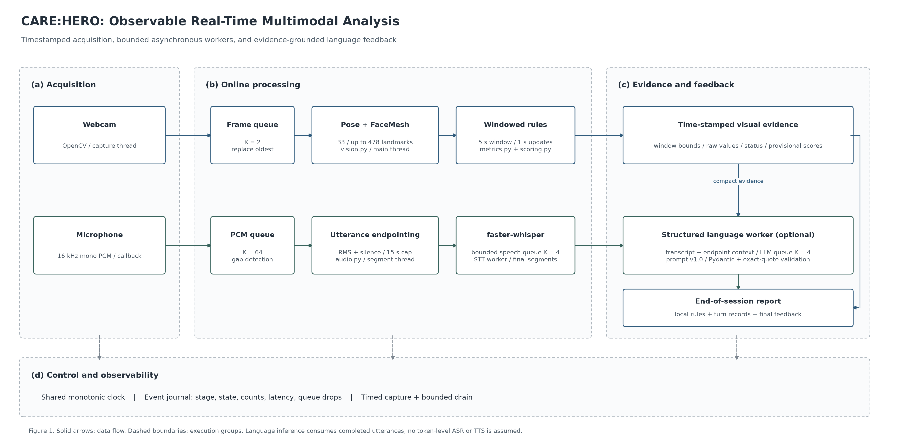

# CARE:HERO 실시간 파이프라인: 코드와 출력 해설

이 문서는 `services/ai/scripts/run_realtime.py`에서 시작하는 실제 실행 경로를 설명한다. 연구용 코드를 처음 읽는 사람도 입력이 어느 모듈에서 처리되고, 어떤 근거가 결과로 남는지 따라갈 수 있게 작성했다.

## 전체 구조



[벡터 SVG](figures/realtime_architecture.svg) · [논문·보고서용 PDF](figures/realtime_architecture.pdf)

Figure 1. 카메라·마이크가 같은 세션 시계를 사용하고, 영상 분석과 발화 기반 전사를 별도 실행 경로에서 처리한다. LLM은 완료된 발화와 자세 요약을 입력받는다. 상태·처리량·지연은 별도 이벤트 파일로 기록한다. 그림에 표시한 길이·큐 크기는 기본 설정값이다.

## 1. 진입점과 설정

[`services/ai/scripts/run_realtime.py`](../services/ai/scripts/run_realtime.py)의 `main()`이 명령행 옵션을 읽는다. 기본 입력은 `OpenCVCamera(0)`이며, `--audio`가 있으면 마이크와 STT가 함께 실행된다. `--audio-only`는 영상 검출기를 초기화하지 않고 음성 경로만 실행한다. `--llm`은 외부 텍스트 API 호출을 명시적으로 활성화한다.

[`settings.py`](../services/ai/src/care_hero/realtime/settings.py)의 Pydantic 모델은 큐 크기, 세션 길이, 발화 길이 같은 설정을 검증한다. `services/ai/configs/realtime.yaml`은 실시간 실행 제어, `services/ai/configs/base.yaml`은 기존 검출기·STT 모델 설정, `services/ai/configs/scenarios/*.yaml`은 평가 기준이다.

| 파일 | 주요 코드 | 담당 역할 |
|---|---|---|
| `services/ai/scripts/run_realtime.py` | `main()` | 모듈 조립과 실행 옵션 |
| `realtime/settings.py` | `RealtimeSettings`, `AudioSettings`, `LLMSettings` | 입력·버퍼·시간 제한 검증 |
| `realtime/contracts.py` | `FrameSource`, `FrameAnalyzer`, `AudioSource`, `TurnTranscriber` | 장치와 모델을 교체할 수 있는 인터페이스 |
| `realtime/session.py` | `RealtimeSession.run()` | 작업 시작, 시간 제어, 상태 기록, 종료·저장 |

## 2. 카메라 입력 → 자세·얼굴 분석

[`capture.py`](../services/ai/src/care_hero/realtime/capture.py)의 `OpenCVCamera.read()`는 OpenCV 프레임을 읽는다. `RealtimeSession._capture()`가 별도 스레드에서 프레임에 `frame_index`와 세션 기준 시간을 붙여 큐에 넣는다.

[`channels.py`](../services/ai/src/care_hero/realtime/channels.py)의 `BoundedChannel`은 최대 크기가 정해진 큐다. 영상 큐가 가득 차면 오래된 프레임을 제거한다. 따라서 느린 추론 때문에 몇 분 전 프레임이 계속 밀려 나오는 대신, 최신 입력 쪽을 처리한다. 제거된 수는 `video.dropped`에 남는다.

[`vision.py`](../services/ai/src/care_hero/realtime/vision.py)의 `VisionAnalyzer.analyze()`는 기존 `pose.py`, `face_mesh.py`를 호출한다. MediaPipe 객체는 메인 스레드에서 한 번 열고 같은 스레드에서 재사용한다. Pose 처리 시간과 FaceMesh 처리 시간을 각각 측정한다. 얼굴 검출기 초기화·처리에 실패하면 얼굴 상태만 `error`로 남기고 Pose 경로를 유지한다.

선택적인 미리보기 창은 원본 프레임 위에 유효한 Pose 연결선과 얼굴 윤곽을 표시한다. `Q` 키는 해당 세션을 종료한다. 화면 위 숫자는 세션 시간·처리 프레임 수·제거 프레임 수다. 한국어 피드백 대신 ASCII 상태를 사용해 OpenCV 기본 글꼴에서도 표시되게 했다.

## 3. 프레임별 좌표 → 시간 구간별 평가

[`metrics.py`](../services/ai/src/care_hero/realtime/metrics.py)의 `OnlineMetrics`는 최근 5초의 슬라이딩 윈도우와 세션 평가용 경량 좌표를 관리한다. 최근 구간은 시간 기준으로 만료시키고, 세션 데이터도 `세션 최대 길이 × 목표 분석 빈도 + 2`개로 제한한다. 원본 영상과 얼굴 좌표 배열은 평가용 누적 버퍼에 저장하지 않는다.

MediaPipe의 x는 영상 너비, y는 높이로 각각 정규화된다. 가로·세로 비율이 다른 화면에서 이를 바로 각도 계산에 사용하면 왜곡된다. 실시간 경로는 `x × (너비/높이)`로 두 축의 단위를 맞춘 뒤 기존 [`scoring.py`](../services/ai/src/care_hero/scoring.py)를 호출한다. 원본 미리보기 좌표는 변경하지 않는다.

`snapshot()`은 최근 구간의 평가, `final_report()`는 보관된 전체 세션 평가다. 최근 구간 평가를 평균해서 최종 점수를 만드는 방식은 아니다. 점수 규칙은 기존 시나리오 YAML을 사용하며, 모두 `provisional` 상태다.

| 평가 항목 | 원시값 | 필요한 좌표 | 해석 범위 |
|---|---|---|---|
| 검출 품질 | Pose 검출 비율 | Pose 검출 여부 | 촬영·분석 품질; 학습자 역량과 구분 필요 |
| 정면 자세 추정 | 코의 어깨 중심 대비 위치가 기준 안에 든 비율 | 코·양 어깨 | 정밀 시선이나 실제 상대 지향성 측정은 아님 |
| 몸통 정렬 | 수직축 대비 좌우 기울기 절댓값 평균 | 양 어깨·양 골반 | 화면 기준 좌우 기울기 |
| 몸통 안정성 | 기울기의 시간적 표준편차 | 여러 프레임의 어깨·골반 | 움직임 크기; 불안·의도 판단은 아님 |

데이터가 부족한 윈도우에서는 `insufficient_data`나 `detection_failed`가 나올 수 있다. 상반신 촬영으로 골반 정보가 부족하면 관련 지표가 `not_applicable`이 된다. 필수 항목이 유효하지 않으면 총점은 `null`이다.

## 4. 마이크 입력 → 발화 구간 확정

`Microphone.start()`는 `sounddevice.InputStream`으로 16 kHz·mono·float32 PCM을 받는다. PortAudio 콜백은 짧은 블록을 복사해 큐에 넣는 일만 한다. 모델 추론과 파일 쓰기는 콜백 밖에서 수행한다.

마이크 시간은 PortAudio의 ADC 시간을 이용해 세션의 monotonic clock으로 변환한다. 마이크 큐가 넘치거나 입력이 끊기면 연속성 오류를 기록하고, [`audio.py`](../services/ai/src/care_hero/realtime/audio.py)의 `SpeechSegmenter`가 진행 중인 발화를 리셋한다. 빠진 부분을 정상적인 연속 음성처럼 이어 붙이지 않는다.

`SpeechSegmenter.push()`는 다음 조건을 사용한다.

1. RMS가 임계값을 넘으면 발화 후보를 시작하고 직전 약 0.2초를 포함한다.
2. 실제 유성 블록이 최소 0.4초 이상 모이면 유효한 발화 후보로 본다.
3. 침묵이 약 0.8초 이어지거나 구간 길이가 15초에 도달하면 발화를 확정한다.
4. 세션 종료 시 `flush()`로 남은 유효 발화를 전달한다.

RMS는 소리 크기에 기반한 단순 분할 기준이다. 소음과 말소리를 완벽히 구분하는 신경망 VAD가 아니며, 실제 공간에서 임계값을 조정해야 한다. 기본 20 ms 블록 때문에 경계는 블록 단위로 양자화된다.

## 5. 완료된 발화 → STT → LLM

`UtteranceTranscriber`는 기존 `FasterWhisperTranscriber`의 모델을 한 번 불러와 재사용한다. 완료된 PCM 배열을 전사하고, Whisper가 반환한 구간 내부 시간을 세션 시작 기준 시간으로 바꾼다.

이 구현은 **실시간 입력 + 발화 단위 준실시간 전사**다. 말하는 도중 토큰마다 수정되는 부분 전사나 매 프레임 LLM 호출을 구현한 것은 아니다. 출력 지연에는 발화 종료 판정, 대기 큐, STT 추론, LLM 요청 시간이 더해진다.

발화가 확정되면 보관된 자세 요약 중 **윈도우 종료 시간이 발화 종료 시간보다 늦지 않은 가장 최근 결과**를 선택한다. 음성 처리 자체가 지연되어도 발화 이후의 미래 구간을 근거에 섞지 않는다. 나중에 STT가 끝나도 선택한 구간을 변경하지 않는다. `vision_context.window_end_seconds`와 `vision_context_age_seconds`로 시차를 확인할 수 있다. 사용 가능한 이전 윈도우가 없으면 빈 문맥을 전달한다. 이 요약은 정밀한 발화-동작 동기화나 인과관계 분석을 뜻하지 않는다.

LLM의 구체적인 입력·출력과 검증 규칙은 [`realtime_llm_engineering.md`](realtime_llm_engineering.md)에 설명한다. 학습자에게는 중간 정답·오답 코칭을 표시하지 않고, 실시간 창은 처리 상태만 보여준다. 언어 해석은 세션 결과에 기록하고 종합 피드백은 종료 후 생성한다. AI 어르신의 다음 대사·TTS는 별도 기능이다.

## 6. 진행 상태와 지연을 읽는 법

[`events.py`](../services/ai/src/care_hero/realtime/events.py)의 `EventJournal.emit()`은 스레드가 동시에 기록해도 순서 번호가 뒤섞이지 않도록 잠금을 사용한다. 이벤트 시간은 세션 객체 생성 기준이며 모델 초기화 시간도 포함한다. 미디어의 `timestamp_seconds`는 모델 초기화 후 시작된 입력 세션 기준이다. 서로 다른 시간 기준을 직접 빼지 않는다.

| 단계 | 주요 상태 | 진행 정보 |
|---|---|---|
| `session` | `initializing → running → draining → completed/partial/stopped` | 입력 경과 시간과 세션 시간 비율 |
| `capture` | `running/done/error/skipped` | 수집 프레임 수, 큐에서 제거된 수 |
| `vision` | `ready/running/done/error` | 처리 프레임 수, Pose·FaceMesh 시간, 입력 대기 지연 |
| `rules` | `running/done` | 생성한 윈도우 수와 최근 평가 상태 |
| `audio` | `running/discontinuity/done/error` | 입력 연속성 오류와 제거 블록 수 |
| `segmentation` | `completed/dropped/done/error` | 발화 경계·분할 사유·처리 블록 수 |
| `stt` | `initializing/ready/running/success/error/done/skipped` | 발화 처리 수와 추론 시간 |
| `llm_turn` | `running/success/error/dropped/skipped` | 발화별 LLM 요청 처리 수·지연 |
| `llm_final` | `running/success/error` | 종료 후 종합 문장 생성 상태 |
| `export` | `running/completed` | 결과 저장 단계 |

계속 들어오는 스트림에는 전체 작업 개수가 정해져 있지 않다. 따라서 모델의 처리 진행률을 임의의 백분율로 만들지 않는다. `session_fraction`은 **설정된 입력 시간 중 경과한 비율**이며, 분석 작업이 그만큼 완료됐다는 뜻은 아니다. 조기 종료나 분석 지연이 있으면 100%가 아니어도 정상이다.

`queue_age_ms`는 카메라 프레임이 분석을 시작하기까지 기다린 시간, `latency_ms`는 해당 작업의 소요 시간, STT의 `output_age_seconds`는 발화 구간 종료 후 결과가 나오기까지의 경과 시간이다. `processed`는 작업 단위에 따라 프레임 수·발화 수·윈도우 수가 된다.

## 7. 결과 파일 해설

| 파일 | 내용 | 사용 목적 |
|---|---|---|
| `events.jsonl` | 단계·상태·개수·지연·드롭; 한 줄에 이벤트 하나 | 개발 중 모니터링과 지연 원인 조사 |
| `windows.jsonl` | 구간 시간과 규칙 기반 원시값·점수·상태 | 시계열 그래프, 특정 구간 재검토 |
| `session.json` | 전체 평가·발화·LLM 결과·설정·잔여 작업 | 재현·프로그램 연동의 기준 결과 |
| `report.md` | 점수 표, 발화 인용, 피드백·다음 연습 | 사람이 읽는 요약 |

`session.json`에서 특히 다음 필드를 확인한다.

| 필드 | 의미 |
|---|---|
| `schema_version` | 실시간 세션 결과 형식 버전 `2.0` |
| `mode` | 실제 장치 실행 `live` 또는 합성 검증 `synthetic_demo` |
| `status` | 정상 종료 `completed`, 사용자 중단 `stopped`, 입력·종료 문제 `partial` |
| `summary` | 분석 프레임 수, 얼굴 검출 수, 평가 좌표계 |
| `rule_based` | 권위 있는 로컬 원시값·평가 상태·provisional 점수 |
| `turns[].transcription` | STT 결과와 세션 기준 타임스탬프 |
| `turns[].vision_context` | 해당 발화 확정 시 보관한 자세 윈도우 |
| `turns[].interpretation` | LLM이 구조화한 발화 내용 관찰 |
| `turns[].llm_status` | 요청 성공·실패·스킵·큐 초과 여부 |
| `queues` | 단계별 제거 개수와 종료 시 남은 대기 작업 |
| `unfinished_workers` | 종료 대기 제한을 넘긴 실행 중 스레드 |
| `llm_manifest` | 선택 모델과 프롬프트 SHA-256; LLM 사용 시 저장 |
| `process_status` | 각 단계의 마지막 이벤트; 전체 이벤트 이력은 `events.jsonl` |

`completed`는 실행 세션이 끝났다는 뜻이다. 모든 프레임의 검출 성공이나 STT·LLM의 의미적 정확성을 보장하지 않는다. 발화별 `stt_status`, `llm_status`, 규칙의 `overall_status`를 함께 확인한다.

## 8. 종료·장애 처리와 재현

입력 시간이 끝나거나 사용자가 종료하면 캡처를 멈추고, 마이크의 마지막 발화를 확정한 뒤 STT와 LLM 큐를 최대 30초 동안 비운다. 제한을 넘긴 작업은 `unfinished_workers`에 남기고 결과를 `partial`로 저장한다. 이미 실행 중인 네이티브 STT 추론을 스레드 수준에서 강제 중단할 수는 없다. 이후 결과가 도착해도 저장된 결과를 변경하지 않는다.

새 실행은 별도 폴더를 사용한다. 같은 폴더에 세션 결과가 있으면 덮어쓰지 않고 오류를 반환한다. 기본 CLI는 시각과 임의의 짧은 ID로 새 폴더를 만든다.

```bash
python services/ai/scripts/run_realtime.py --demo --duration 4
python services/ai/scripts/render_realtime_prompts.py
python -m pytest services/ai/tests/test_realtime_audio.py services/ai/tests/test_realtime_language.py services/ai/tests/test_realtime_session.py -q
```

`--demo`는 실제 장치·모델·API를 사용하지 않는 합성 통합 시험이다. 실제 카메라·마이크 권한, 소음 환경의 STT 정확도, API 응답 지연은 실제 환경에서 별도 검증해야 한다.
