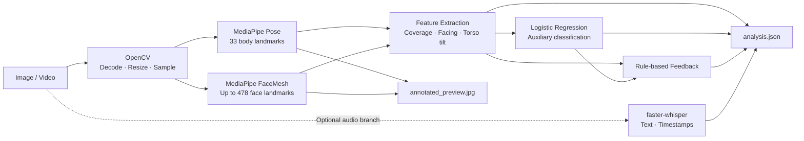

# CARE:HERO

실시간 카메라·마이크 입력과 비동기 처리 프레임워크는 [상위 프로젝트 README](../../README.md)에 있습니다. 이 폴더는 독립형 batch 학습·평가 예제를 설명합니다.

**A Reproducible Baseline for Video-based Caregiving Training Analysis**

요양보호사 대응 연습 영상에서 자세·얼굴 좌표와 발화 내용을 추출하고, 관찰 가능한 행동 특징을 분석하는 연구용 파이프라인.

[Overview](#overview) · [Architecture](#architecture) · [Quick Start](#quick-start) · [Training](#training) · [Evaluation](#evaluation) · [References](#references)

## Overview

CARE:HERO는 요양보호사 교육생이 돌봄 상황에서 자신의 대응을 돌아보고 반복 연습하도록 돕는 프로젝트입니다. 이 폴더는 그중 **촬영된 이미지·영상의 행동 분석 과정**을 독립적으로 실행할 수 있게 정리한 기준 구현(baseline)입니다.

사전학습된 MediaPipe Pose와 FaceMesh로 몸과 얼굴의 좌표를 검출한 뒤, 검출률·정면 유지 비율·몸통 기울기 등 설명 가능한 특징을 계산합니다. 추출한 특징은 작은 분류 모델과 규칙 기반 피드백에 사용하며, 선택적으로 faster-whisper를 연결해 발화 텍스트와 시간 구간을 기록합니다.

코드를 처음 읽는 사람도 `pipeline.py`에서 전체 흐름을 따라가고, 모델 학습·평가·추론을 각각 실행할 수 있도록 구성했습니다.

> **Research status.** 포함된 행동 분류 가중치는 합성 데이터 24개로 학습한 예제입니다. 아래 실험 결과는 코드 재현 확인용이며, 실제 교육 효과나 사용자 대응 역량에 대한 검증 결과가 아닙니다.

### Supported capabilities

| 구성 요소 | 현재 동작 |
|---|---|
| 미디어 입력 | 이미지 1장 또는 로컬 영상 파일 읽기, 영상 프레임 간격 샘플링 |
| Pose | 프레임별 몸 관절 33개 검출 및 가시성 기준의 유효 좌표 수 계산 |
| FaceMesh | 한 명의 얼굴 좌표 검출 및 미리보기 시각화; 기본 설정에서 최대 478개 |
| 촬영 범위 | 전신·상반신·혼합 범위 구분 |
| 특징 추출 | 검출률, 정면 유지 비율, 몸통 기울기 평균·표준편차 등 6개 특징 |
| 보조 분류 모델 | NumPy 로지스틱 회귀 학습과 개선 필요 클래스의 출력값 계산 |
| 발화 전사 | 선택적 faster-whisper 연동; 한국어 텍스트와 시작·종료 시간 반환 |
| 결과 저장 | JSON 분석 결과와 첫 분석 프레임의 Pose·FaceMesh 오버레이 이미지 |

실시간 AI 어르신 대화, 시나리오 분기, 감정·공감 평가, 관리자 대시보드는 이 폴더의 구현 범위에 포함되지 않습니다.

## Architecture



영상 분석과 음성 전사는 독립적으로 수행됩니다. 현재 분류 모델에는 영상에서 계산한 특징만 입력되며, 전사 텍스트는 결과 JSON에 함께 저장됩니다.

### Model components

| 모델 | 입력 → 출력 | 파이프라인에서의 역할 | 학습 방식 |
|---|---|---|---|
| MediaPipe Pose | RGB 프레임 → 몸 관절 좌표·가시성 | 자세 특징과 촬영 범위 계산 | 사전학습 모델 추론 |
| MediaPipe FaceMesh | RGB 프레임 → 얼굴 좌표 | 얼굴 검출 여부 확인·오버레이 | 사전학습 모델 추론 |
| `BeginnerBehaviorModel` | 6개 요약 특징 → 이진 분류 출력 | 개선 필요 클래스에 대한 보조 실험 | `train.py`로 학습 |
| faster-whisper | 영상의 음성 → 텍스트·시간 구간 | 어떤 말을 했는지 기록 | 사전학습 모델 추론 |

현재 구현은 `mediapipe==0.10.21`의 **Solutions API**를 사용합니다. API 사용법은 해당 버전의 [Pose 문서](https://github.com/google-ai-edge/mediapipe/blob/v0.10.21/docs/solutions/pose.md)와 [FaceMesh 문서](https://github.com/google-ai-edge/mediapipe/blob/v0.10.21/docs/solutions/face_mesh.md)를 참고하세요.

## Repository Structure

```text
beginner_pipeline/
├── README.md
├── requirements.txt
├── config.json                       # 검출·크기 조정 설정
├── run_pipeline.py                   # 추론 CLI
├── pipeline.py                       # 입력 → 검출 → 특징 → 결과 저장
├── features.py                       # 설명 가능한 수치 특징
├── model.py                          # NumPy 로지스틱 회귀
├── train.py                          # 모델 학습
├── eval.py                           # 모델 평가
├── feedback.py                       # 규칙 기반 문장 피드백
├── stt.py                            # 선택적 발화 전사
├── data/
│   ├── README.md
│   ├── demo_train.csv                # 합성 학습 데이터 24개
│   └── demo_eval.csv                 # 합성 평가 데이터 8개
├── weights/
│   ├── README.md
│   ├── behavior_model.json           # 보조 분류 모델 가중치
│   ├── manifest.sha256               # 배포 시점의 파일 해시
│   └── mediapipe/                    # MediaPipe 사전학습 .tflite 4개
├── tests/                            # 특징·모델·평가지표 단위 테스트
├── reference/                        # 최소 실행 예제·처리 순서 참고 코드
└── outputs/                          # 실행 결과
```

## Quick Start

이하 명령은 모두 **`beginner_pipeline/` 폴더 안에서** 실행합니다. 코드 폴더를 복사해 단독으로 사용하는 경우에도 같은 명령을 사용할 수 있습니다.

### 1. Environment

검증 환경: Python **3.11.2**, macOS **arm64**, MediaPipe **0.10.21**, NumPy **1.26.4**, OpenCV **4.11.0.86**.

```bash
cd experiments/beginner_pipeline
python3.11 -m venv .venv
source .venv/bin/activate
python -m pip install -r requirements.txt
```

상위 CARE_HERO 프로젝트의 가상환경을 이미 사용 중이라면, 해당 환경을 활성화한 상태에서 `requirements.txt`만 설치하면 됩니다. 위 검증 환경 외의 운영체제·Python 버전은 별도 확인이 필요합니다.

### 2. Inference

포함된 `weights/behavior_model.json`을 사용하면 추가 학습 없이 추론을 실행할 수 있습니다.

```bash
# 이미지 분석
python run_pipeline.py /path/to/image.jpg

# 영상 분석: 5프레임마다 1장 처리
python run_pipeline.py /path/to/video.mp4 --sample-every 5

# 저장 위치와 분류 모델 가중치 지정
python run_pipeline.py /path/to/video.mp4 \
  --weights weights/behavior_model.json \
  --output outputs/my_experiment
```

이미지 지원 확장자: `.jpg`, `.jpeg`, `.png`, `.bmp`, `.webp`.
영상 지원 확장자: `.mp4`, `.mov`, `.avi`, `.mkv`, `.webm`. 실제 디코딩 가능 여부는 파일의 코덱과 OpenCV 환경에 따라 달라집니다.

### 3. Optional Speech Transcription

```bash
python -m pip install 'faster-whisper>=1.1,<2'
python run_pipeline.py /path/to/video.mp4 --stt --whisper-model small
```

기본 실행 설정은 `language="ko"`, `device="cpu"`, `compute_type="int8"`, `vad_filter=True`입니다. 모델 이름을 사용하면 첫 실행 때 [faster-whisper 모델을 내려받아 캐시](https://github.com/SYSTRAN/faster-whisper#model-conversion)할 수 있습니다. STT 가중치는 이 폴더에 포함되어 있지 않습니다.

## Method

### Landmark Extraction and Coverage

OpenCV로 읽은 BGR 프레임을 RGB로 바꾸고 Pose와 FaceMesh에 입력합니다. 각 검출기는 분석 세션 동안 한 번 초기화해 여러 프레임에 재사용합니다.

Pose는 검출 성공 시 33개 좌표를 반환합니다. 이 중 **유효 Pose 좌표 수**는 `visibility >= 0.5`를 만족하는 좌표 수입니다. 반환된 전체 좌표 수와 유효 좌표 수를 별도로 기록하므로, 상반신 사진에서 `33개 반환`과 `13개 유효`가 동시에 나타날 수 있습니다. 가시성 기준은 좌표 사용 여부를 정하는 휴리스틱이며 실제 정답 좌표와의 일치를 보장하지 않습니다.

촬영 범위는 코·양 어깨가 유효한 프레임에서 무릎·발목 4개 중 유효한 좌표 수로 구분합니다.

| 프레임 상태 | 판정 기준 |
|---|---|
| `full_body` | 무릎·발목 중 3개 이상 유효 |
| `upper_body` | 무릎·발목 중 1개 이하 유효 |
| `mixed` | 그 외의 조합 또는 코·어깨 좌표 부족 |
| `detection_failed` | Pose 검출 실패 |

전체 분석 프레임의 60% 이상이 전신 또는 상반신이면 그 범위를 영상 요약에 사용하고, 나머지는 `mixed`로 요약합니다. 검출 실패 비율은 별도로 함께 확인해야 합니다.

### Feature Definition

| 특징 | 정의 | 범위·단위 |
|---|---|---|
| `pose_detection_rate` | Pose 검출 성공 프레임 수 / 전체 분석 프레임 수 | 0–1 |
| `face_detection_rate` | 얼굴 검출 성공 프레임 수 / 전체 분석 프레임 수 | 0–1 |
| `front_facing_ratio` | 코가 양 어깨 중앙 기준 범위 안에 있는 비율; 계산 가능한 프레임 기준 | 0–1 |
| `mean_abs_torso_tilt_deg` | 어깨 중앙–골반 중앙 선의 수직축 대비 좌우 기울기 절댓값 평균 | degree |
| `torso_tilt_std_deg` | 프레임 간 몸통 기울기 값의 표준편차; 최소 2개 측정 필요 | degree |
| `upper_body_ratio` | 상반신 판정 프레임 수 / 전체 분석 프레임 수 | 0–1 |

정면 유지 비율은 코의 가로 위치가 어깨 중앙에서 얼마나 벗어났는지 어깨 너비로 나눈 값으로 계산합니다. 기본 기준은 `0.35`이며, 정밀한 머리 방향이나 시선 측정값으로 해석해서는 안 됩니다.

골반 좌표가 부족한 프레임에서는 몸통 기울기를 계산하지 않고, 요약값이 없으면 JSON에 `null`로 저장합니다. 이미지 1장은 시간에 따른 움직임 변화를 제공하지 않으므로 기울기 표준편차가 `null`일 수 있습니다.

### Auxiliary Classifier

[`model.py`](model.py)의 `BeginnerBehaviorModel`은 6개 특징으로 `needs_improvement`를 학습하는 로지스틱 회귀 모델입니다.

1. 학습 데이터에서 특징별 평균을 구하고, 누락된 값을 해당 평균으로 대체합니다.
2. 몸통 기울기 평균·표준편차의 누락 여부를 나타내는 2개 표시값을 추가합니다.
3. 총 8개 입력을 학습 데이터의 평균·표준편차로 표준화합니다.
4. `p = sigmoid(wᵀx + b)`를 계산하고, 이진 교차 엔트로피와 L2 정규화로 가중치를 학습합니다.

`needs_improvement=1`은 개선 필요 클래스, `0`은 그 반대 클래스입니다. 평가 시 기본 분류 임계값은 `0.5`입니다. 반환값은 보정되지 않은 모델 출력이며, 실제 개선 필요 확률로 사용하려면 별도 검증이 필요합니다.

학습한 평균·표준편차·가중치·편향은 하나의 JSON에 저장되어 추론 시 재사용됩니다. 원시 측정값의 `null`과 분류 모델 내부의 평균 대체 처리는 구분됩니다.

## Data

포함 데이터는 실사용자 촬영 데이터가 아닌 **수작업 합성 특징 표**입니다. 실제 인물 영상에서 추출하거나 교육 전문가가 라벨링한 데이터가 아닙니다.

| 파일 | 샘플 수 | 용도 |
|---|---:|---|
| `data/demo_train.csv` | 24 | 분류 모델 학습 |
| `data/demo_eval.csv` | 8 | 별도 파일을 사용한 코드 동작 평가 |

CSV에는 위 6개 특징과 `needs_improvement` 열이 필요합니다. 계산 불가 항목은 빈 셀로 둡니다.

```csv
pose_detection_rate,face_detection_rate,front_facing_ratio,mean_abs_torso_tilt_deg,torso_tilt_std_deg,upper_body_ratio,needs_improvement
0.98,0.97,0.95,2.0,1.1,0.05,0
0.97,0.98,0.92,,,0.92,0
0.68,0.72,0.55,12.0,7.0,0.25,1
```

이 CSV가 곧바로 영상 데이터셋을 뜻하지는 않습니다. 실제 연구 데이터는 영상별 특징 추출, 전문가 라벨링, 참여자 단위의 학습·검증·평가 분리를 거쳐 준비해야 합니다. 자세한 열 설명은 [`data/README.md`](data/README.md)에 있습니다.

## Training

```bash
# 포함된 합성 데이터로 학습; 기본 가중치 파일 갱신
python train.py

# 데이터·저장 위치·학습 설정 지정
python train.py \
  --data data/demo_train.csv \
  --output outputs/reproduction/behavior_model.json \
  --epochs 3000 \
  --learning-rate 0.08
```

| 설정 | 기본값 |
|---|---:|
| 학습 반복 수 | 3,000 |
| 학습률 | 0.08 |
| L2 정규화 계수 | 0.01 |
| 최적화 | 전체 학습 데이터를 사용하는 경사하강법 |
| 초기 가중치·편향 | 모두 0 |

L2 계수는 `model.py`의 `fit(l2_strength=...)` 인자에서 설정합니다. 학습·평가 CSV는 사용자가 지정하며 자동 데이터 분할은 수행하지 않습니다. 동일 데이터와 설정에서 같은 초기값으로 학습하므로 임의의 난수 시드가 필요하지 않습니다.

## Evaluation

```bash
# 포함된 기본 가중치 평가
python eval.py

# 재현 실험에서 생성한 가중치 평가
python eval.py \
  --data data/demo_eval.csv \
  --weights outputs/reproduction/behavior_model.json \
  --threshold 0.5

# 특징 계산·모델 저장/복원·평가지표 단위 테스트
python -m pytest tests -q
```

### Reproduction Results

아래는 포함된 가중치와 합성 평가 데이터 8개로 재현한 결과입니다. 양성 클래스는 `needs_improvement=1`입니다.

| 평가 대상 | Accuracy | Precision | Recall | F1 |
|---|---:|---:|---:|---:|
| 합성 예제 분류 | 1.000 | 1.000 | 1.000 | 1.000 |

혼동 행렬: `TP=4`, `TN=4`, `FP=0`, `FN=0`. 단위 테스트: **7 passed**.

이 값은 작은 합성 데이터에서 학습·추론 코드가 동작함을 확인한 결과입니다. Pose·FaceMesh의 좌표 정확도, 한국어 STT 정확도, 처리 속도, 실제 사용자 대상 분류 성능은 이 평가에 포함되지 않습니다. 실제 영상 데이터셋 성능과 비교 기준 모델에 대한 실험은 후속 과제입니다.

## Checkpoints

| 파일 | 출처 | 용도 |
|---|---|---|
| `weights/behavior_model.json` | 포함된 합성 데이터로 학습 | 8개 입력에 대한 분류 가중치와 전처리 통계 |
| `weights/mediapipe/pose_detection.tflite` | MediaPipe 0.10.21 패키지 | 사람 영역 탐색 |
| `weights/mediapipe/pose_landmark_full.tflite` | MediaPipe 0.10.21 패키지 | 몸 관절 좌표 예측 |
| `weights/mediapipe/face_detection_short_range.tflite` | MediaPipe 0.10.21 패키지 | 얼굴 영역 탐색 |
| `weights/mediapipe/face_landmark_with_attention.tflite` | MediaPipe 0.10.21 패키지 | 얼굴 세부 좌표 예측 |

MediaPipe 추론은 설치된 패키지 내부의 가중치를 자동으로 읽습니다. `weights/mediapipe/`의 파일은 동일 모델을 확인할 수 있게 보관한 복사본이며, `--weights`는 **행동 분류 모델의 JSON 경로**를 지정하는 옵션입니다.

패키지에서 사전학습 파일을 다시 복사하거나 배포 시점의 해시를 확인하려면 다음을 실행합니다.

```bash
python reference/copy_mediapipe_weights.py
(cd weights && shasum -a 256 -c manifest.sha256)
```

`manifest.sha256`은 포함된 파일의 해시입니다. 가중치를 직접 수정하거나 다시 학습해 내용이 바뀌었다면 해당 파일의 해시도 달라집니다. 상세 내용은 [`weights/README.md`](weights/README.md)를 참고하세요.

## Outputs and Configuration

기본 결과 경로는 `outputs/<입력파일명>/`입니다.

```text
outputs/<input_name>/
├── analysis.json
└── annotated_preview.jpg
```

| JSON 필드 | 내용 |
|---|---|
| `input` | 입력 경로, 원본·분석 해상도, 영상 메타데이터 |
| `pipeline` | 사용한 검출기·분류 모델·STT 실행 여부 |
| `summary` | 분석·검출 프레임 수, 촬영 범위, 6개 특징, 측정 한계 |
| `behavior_model` | 가중치 경로, 실행 상태, 개선 필요 클래스 출력값 |
| `feedback` | 측정 결과를 설명하는 규칙 기반 문장 |
| `frames` | 프레임별 시간, 유효 Pose 좌표 수, FaceMesh 좌표 수, 특징 |
| `stt` | `--stt` 실행 시 텍스트와 시작·종료 시간 |

`annotated_preview.jpg`는 첫 분석 프레임의 시각화입니다. JSON에는 좌표 개수와 계산한 특징을 저장하며, 얼굴 전체 좌표 배열이나 오버레이 영상은 저장하지 않습니다. 같은 출력 폴더로 다시 실행하면 결과 파일이 갱신됩니다.

[`config.json`](config.json)의 주요 설정은 다음과 같습니다.

| 설정 | 기본값 | 의미 |
|---|---:|---|
| `maximum_analysis_width` / `maximum_analysis_height` | 1280 / 720 | 원본 비율을 유지하는 분석 해상도 상한 |
| `minimum_landmark_visibility` | 0.5 | Pose 좌표 사용 기준 |
| `front_facing_maximum_offset` | 0.35 | 어깨 너비 대비 코 위치 허용 범위 |
| `pose_model_complexity` | 1 | Pose 모델 복잡도 |
| `minimum_detection_confidence` | 0.5 | 검출 신뢰도 기준 |
| `minimum_tracking_confidence` | 0.5 | 추적 신뢰도 기준 |
| `refine_face_landmarks` | `true` | 얼굴 세부 좌표와 홍채 좌표 사용 |

## Limitations and Future Work

현재 관찰값은 카메라에서 추정한 2D 좌표에 기반합니다. 촬영 각도, 가림, 조명과 프레임 간격이 결과에 영향을 주며, 좌표 가시성이나 검출률만으로 교육생의 대응 품질을 판단하기는 어렵습니다. FaceMesh는 얼굴 좌표 검출에 사용하고, 표정의 의미·감정·공감 여부는 별도 검증이 필요한 연구 과제로 남아 있습니다.

보조 분류 모델은 누락값을 학습 평균으로 대체해 출력을 계산합니다. 현재는 데이터가 부족할 때 출력을 보류하는 기준이나 예측값의 확률 보정이 구현되어 있지 않습니다. 실제 교육 평가에 적용하려면 전문가 라벨, 측정 신뢰도 기준과 실제 사용자 대상 검증이 필요합니다.

- [ ] 참여자·촬영 환경을 구분한 실제 영상 데이터셋 구축 및 전문가 라벨링
- [ ] 데이터 부족 시 판단 보류, 촬영 범위별 평가 기준 마련
- [ ] 실제 데이터에서 기준 모델 비교, 특징별 기여도 실험과 확률 보정
- [ ] 한국어 STT의 문자·단어 오류율 및 구간별 처리 지연 측정
- [ ] 얼굴·음성 특징과 대응 시나리오를 연결하는 평가 기준 검증
- [ ] 대화·시나리오 분기와 교육 리포트·대시보드 연동

## References

1. Lugaresi et al. **MediaPipe: A Framework for Building Perception Pipelines.** 2019. [Paper](https://arxiv.org/abs/1906.08172)
2. Bazarevsky et al. **BlazePose: On-device Real-time Body Pose tracking.** 2020. [Paper](https://arxiv.org/abs/2006.10204)
3. Google MediaPipe. **Pose / FaceMesh Solutions, v0.10.21.** [Pose](https://github.com/google-ai-edge/mediapipe/blob/v0.10.21/docs/solutions/pose.md) · [FaceMesh](https://github.com/google-ai-edge/mediapipe/blob/v0.10.21/docs/solutions/face_mesh.md)
4. Radford et al. **Robust Speech Recognition via Large-Scale Weak Supervision.** 2022. [Paper](https://arxiv.org/abs/2212.04356)
5. SYSTRAN. **faster-whisper: Faster Whisper transcription with CTranslate2.** [Code](https://github.com/SYSTRAN/faster-whisper)

기술별 최소 예제와 처리 순서 참고 코드는 [`reference/`](reference/README.md)에 있습니다.
